
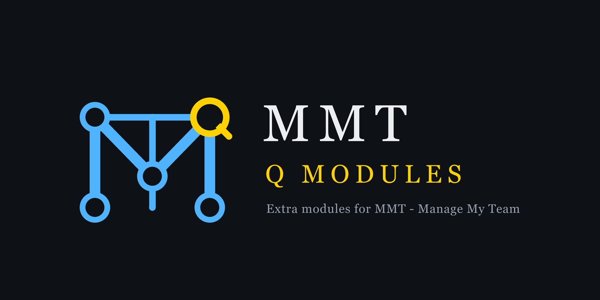

# Quiding's MMT modules

Modules for [MMT - Manage My Team](https://github.com/bnetworking/MMT), a multiboxing addon for
World of Warcraft: Forever. Each module is its own addon folder and shows up in `/mmt` under
MODULES, with its own settings page.

> **Updated daily:** these modules are still young and get fixed almost every day as bugs are found in play.
> Update often, and if something breaks, check here for a newer version first.

| Module | What it does | Version |
| --- | --- | --- |
| [Cooldown Timers](#cooldown-timers) | Bars with every member's important cooldowns | 0.17.0 |
| [Buff Timers](#buff-timers) | Who has, and who misses, the buffs you track | 0.21.0 |
| [Totems](#totems) | Totem bars for the team's shamans *(not heavily tested yet)* | 0.4.9 |
| [Pawn Compare](#pawn-compare) | Pawn scores for the whole team in the item tooltips, delete or hide Pawn scales team-wide | 0.5.1 |
| [Team Gear](#team-gear) | Any member's equipped gear and talents, like inspecting them | 0.3.0 |
| [Team Inventory](#team-inventory) | Item counts and bags across all accounts *(not heavily tested yet)* | 0.10.4 |
| [Whispers](#whispers) | Your alts' whispers on the character you play | 0.1.4 |
| [Quality of life](#quality-of-life) | Dejunk lists and Baganator categories, the same on the whole team; send ForeverAuras auras and EllesmereUI profiles to the team; SmartBuff alerts called out to the leader *(new, not tested in game yet)* | 0.6.8 |
| [Styles](#styles) | Another look for MMT's settings and windows: ElvUI-like, EllesmereUI-like, Modern Blizzard or Classic (the game's own window art) *(new, not tested in game yet)* | 0.3.1 |

> **Renamed:** Cooldowns is now **Cooldown Timers** (`MMT_CooldownTimers`, `/mmtct`) and Buffs is now **Buff Timers**
> (`MMT_BuffTimers`, `/mmtbt`). Delete the old `MMT_Cooldowns` / `MMT_Buffs` folders when you update - your
> settings are taken over automatically.

## Install

1. Copy the `MMT_*` folders next to the `MMT` folder in
   `World of Warcraft/_forever_/Interface/AddOns/` on every client.
2. `/reload` (or log in) and switch the modules on under `/mmt` > MODULES if needed. **Styles, Totems, Quality of
   life and Pawn Compare start switched off** on a new install (MMT's `DefaultState: disabled`, see
   [MMT's guide for modules](https://github.com/bnetworking/MMT/blob/main/CreateModules.md)); the others start on.
   A module you already had keeps the state you gave it.
3. Recommended: [Baganator](https://www.curseforge.com/wow/addons/baganator) - Team Inventory then
   uses its categories and puts its tooltip lines right below Baganator's.

**Moving the windows** (Cooldown Timers, Buff Timers, Totems): while a window is unlocked, a small tab shows above
its top-left corner when the mouse is over it - drag the tab to move the window (the background still works too).

**Arranging the bars** (Cooldown Timers and Buff Timers): **Arrange icons** on the Bars tab, or `/mmtct arrange` /
`/mmtbt arrange`, until you click it again or `/reload` (the lock doesn't matter). Every member's row then shows
everything their lists track - the hide options (not learned, nobody here can cast it, Only for, one blessing per
paladin, hide ready, ...) wait - and each icon gets dots in its corner: drag it along its row to move it. It moves
within the list it comes from (class, All bar, race, role, character), so a line shows where it can land and dropping
it past the others of its list puts it at that list's end. Arrange mode covers both modules' bars at once: drag a
buff onto a member's Cooldown Timers bar (or a cooldown onto a Buff Timers bar) and that buff shows there for
everyone, at the spot you dropped it; drag it back onto its own bar to bring it home (while arranging, a member's bar stays up even with nothing left
in it, as a faint slot to drop on). Buff icons on the Cooldown
Timers bars - moved one by one, or all of them with "Where: On the Cooldowns bars" - can be dropped anywhere in the
row, between the cooldowns; switching "Where" back to its own window brings them all home.

**Beside the party frames** (Cooldown Timers and Buff Timers, **Frames** tab): each member's icons sit next
to their own party or raid frame instead of in the window - right, left, above or below it, with X / Y offsets and
their own icon size (up to 100, or as high as the frame) - and follow the frames when they are re-sorted (EUI_NameSort, EllesmereUI's sort), moved, or
the group changes. Works with EllesmereUI's party and raid frames and Blizzard's party / raid frames. Members
without a frame (not in your group) stay in the window, or are hidden. With both modules on the same side the buffs
come after the cooldowns; Buff icons attached to the Cooldown Timers bars come along. Buff Timers' **All bar** can sit
above the party frames or stay a free window. Only our own icons are placed - the unit frames are never touched, and
it keeps working in combat.

Cooldown Timers and Buff Timers have a **Preview** (Bars tab, or `/mmtct preview` / `/mmtbt preview`): every team
member gets a row with made-up states, to set up the look and position without the team around -
with the team's real classes, **mixed classes** (`/mmtct preview mixed`: warrior, paladin, priest, ...), or
**all classes** (`/mmtct preview all`: nine made-up characters, one of every class).

**Spec lists** (Cooldown Timers and Buff Timers, **Specs** tab, "Use spec lists"): a member whose talent spec is known
tracks their spec's list (Paladin: Holy, Paladin: Retribution, ...) instead of their class list, so a Holy and a
Retribution paladin track different things. Each spec list starts as that spec's preset. The spec is the talent tree
with the most points, shared over MMT's heartbeat and once on a respec; a feral druid counts as the bear tank spec
while their role is Tank. On the Specs tab you can also set a member's spec by hand (a character without talents
yet, or to see a spec in the preview); a spec set in one of the two modules counts in both. Members whose spec isn't
known keep the class list.

Cooldown Timers and Buff Timers split their **Look** tab into sub-tabs: **Window** (sizes, font, background,
border), **Icons** (opacity, missing buffs, the All bar counter) and **Timer**: the timer text's size and colour, the
colour and opacity of the countdown circle that runs round an icon, and other colours for both once only a few
seconds are left ("soon" and "urgent", each with its own number of seconds; 0 = off).

Every settings page has **Sync to team** (MMT's own: the other clients are asked first) and
**Reset to defaults** (click twice). Cooldown Timers, Buff Timers and Totems also have **Import / Export** as a
text string, a growth direction (top > down, down > top, left > right, right > left) and
background / border / font options.

---

## Cooldown Timers

Port of [EMA Cooldowns](https://github.com/Quiding/ema_cooldowns): one row per member with their
important spells, trinkets and potions.

- Every client sends **one short message** when its character uses a tracked cooldown (exact time
  left), so members outside the group are tracked too; group members are also seen directly.
- A `/reload` or relog keeps the team's running timers, and each member is asked once for theirs when they're
  seen again (cooldowns used while you were away show up too).
- Cooldown lengths are the real ones: your own from the game, the team's from that message (talents and
  other reductions included), remembered for the next time. The seconds in a list are only the fallback - click
  them to change.
- While a spell's buff is up (Berserking, Evasion, Death Wish, trinkets, ...) its icon glows with
  the buff's time left.
- "Hide what you don't have": spells a character hasn't learned yet are hidden on every client's bars
  (each client tells the team which tracked spells it hasn't learned), and items you don't carry on your own row.
- Lists per class, race, MMT role or character; entries can be switched off without deleting them.
- **Reorder a list by dragging** an entry by its dots (a line shows where it lands; hold it above or below the list
  to scroll), or drag the icons on the bars themselves in arrange mode (see below).
- **Presets per spec** (all 28, Feral split into cat and bear) from Wowhead's WoW: Forever class guides: big
  cooldowns, defensives and control on, the rotation in the list but off; racials per race, potions & runes.
- **Name search** in the add box: every spell (also ones your character doesn't know) and the items
  you carry; shift-click a spell or item works too.

`/mmtct` · `/mmtct test` · `/mmtct preview [mixed|all]` · `/mmtct export`

| | |
| --- | --- |
| 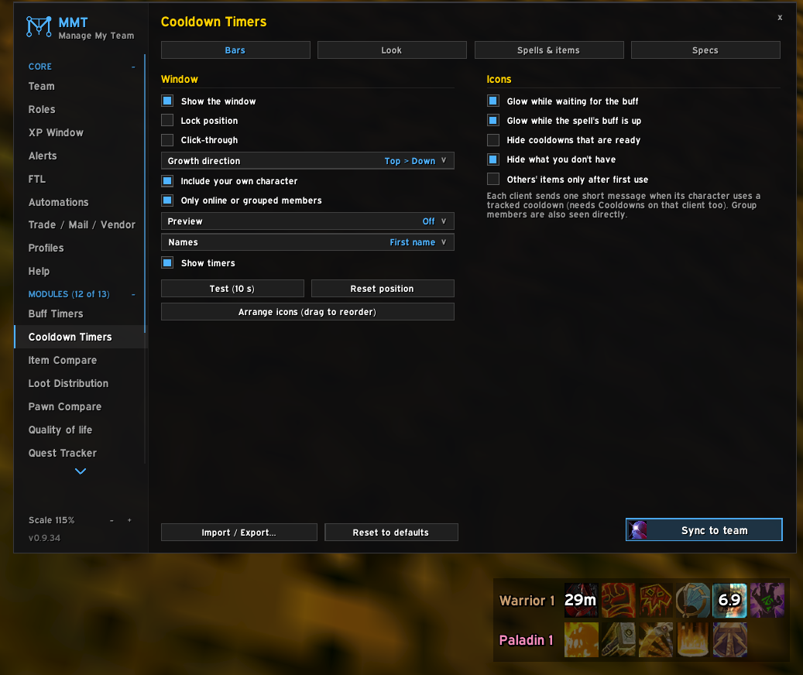 | 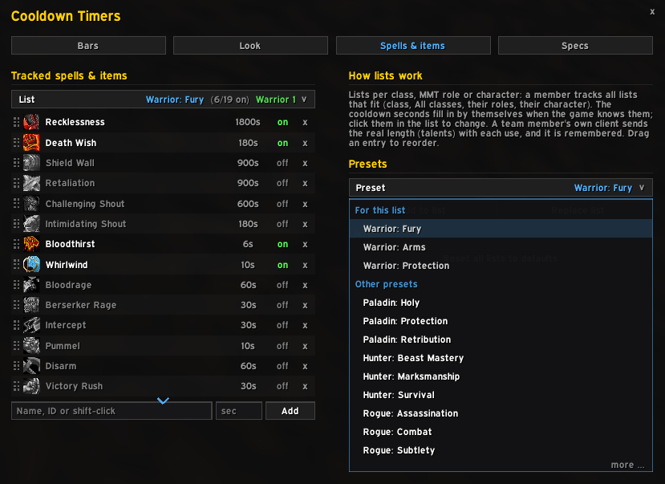 |

## Buff Timers

**SmartBuff alerts glow** (Bars tab, "Glow on SmartBuff alerts", on by default): when SmartBuff says a member needs a
buff - your own SmartBuff, or the team's alerts sent by Quality of life's SmartBuff alerts - that buff's icon glows in
the member's row and on the All bar until they have it again (a greater blessing counts as the single one).

Port of [EMA Buffs](https://github.com/Quiding/ema_buffs): which group members have or miss the buffs
tracked for them, with exact timers.

- Any rank counts, and group versions too (Prayer of Fortitude, Greater Blessings, ...).
- **Name patterns**: add `Seal of *` (a `*` = any text) and one icon shows whichever seal is up, with its own
  icon and timer. The paladin presets track any seal this way, the hunter presets any aspect (`Aspect of the *`).
- **Weapon enchants**: add `main hand` / `off hand` - any enchant on that weapon counts (shaman imbues, rogue
  poisons, oils, sharpening stones), with its time left. Other members' clients send theirs once when it
  changes (they need Buff Timers 0.12+). In the rogue and Enhancement presets, and as an All bar preset.
- **Shaman totems** preset for the All bar (Strength of Earth, Grace of Air, Windfury Totem, Mana Spring, ...):
  on Forever these are buffs on the members, shown only while a shaman is in the group or online. A totem only
  reaches the shaman's own party.
- Own window, or attached to the Cooldown Timers bars.
- Missing buffs: normal icon, red or grey, optionally glowing, at their own opacity.
- Class buffs (Fortitude, Mark of the Wild, Blessings, Arcane Intellect, ...) only show when someone of
  that class is in your group or online in your team (switchable).
- **One blessing per paladin** (on by default): a member can only have one blessing from each paladin, so once they
  have as many as there are paladins in the group, the other blessings tracked for them don't count as missing.
  Blessings from paladins outside the group (randoms) don't use up a slot. Salvation isn't a blessing on Forever
  (it stacks with them), so it never counts.
- **Hide buffs not learned yet** (on by default): a class buff a character hasn't learned yet (Inner Fire, a seal,
  an armor) leaves their row, and a buff cast on others only shows while someone here has learned it. Each client
  tells the team once what it hasn't learned, like Cooldown Timers' "Hide what you don't have".
- **Reorder a list by dragging** a buff by its dots up or down in the Buffs tab (a line shows where it lands; hold it above or
  below the list to scroll), or drag the icons on the bars themselves in arrange mode (see below).
- **All bar**: the team-wide buffs in one place (missing when anyone lacks one, otherwise the
  shortest time left); members can be left out of it.
- All bar counter: while someone misses a buff, "have / checked" in a corner of its icon (3/5 = 3 of the 5
  members it's checked on have it; the tooltip says who misses it). Nothing once everyone has it - corner, size and
  colour in Look.
- The All bar starts with the party buffs (no auras), for everyone; limit them with the cog.
- Presets: raid buffs (the party buffs), raid buffs + auras, world buffs, flasks & elixirs, and per spec (the
  buffs that spec keeps up on itself: seals, aspects, armors, forms, Slice and Dice, ...); and
  the same name search as Cooldown Timers.
- **Only for...** (the cog of each buff in the All bar): limit a buff to specs (Paladin: Retribution, ...), player roles (Tank / Healer / Melee / Ranged /
  Caster), classes and / or MMT roles - e.g. Blessing of Might only for Melee and Tank. Members it isn't
  for don't count as missing it. Player roles are automatic: a druid's form, else the talent tree with the
  most points (shared with the team, also right after a respec or dual spec swap), else the class; set
  them by hand on the Roles tab.

`/mmtbt` · `/mmtbt test` · `/mmtbt preview [mixed|all]` · `/mmtbt export`

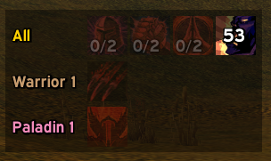

| | |
| --- | --- |
|  | 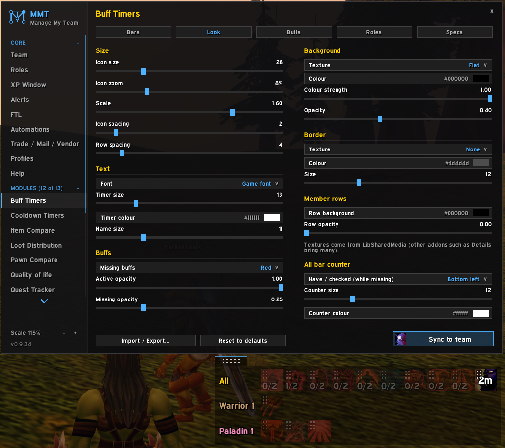 |

## Totems

*Probably not ready yet, not heavily tested.* Port of
[EMA Totems](https://github.com/Quiding/ema_totems): a bar per shaman (Fire, Air, Water, Earth).

- Active totem with its timer, else the chosen / last one.
- Right-click a slot to choose a totem (only the ones that shaman has learned), left-click your own
  to cast it. Works from every client: a warrior can set the shaman's totems.
- A cast sequence (reorder the four element buttons) on a key, spam-safe option.
- Individual and team presets (P / TP buttons), grouped or ungrouped bars.
- Slots hide when the shaman has no totem item or no totem of that element learned yet, judged by that
  shaman's own spells and bags (every client shows the same bar).
- **Practice shaman** (Bars tab, or `/mmtt practice`): a made-up bar to set things up when no shaman is
  around. It knows every totem, nothing about it is sent to the team, and it's gone after a `/reload`.

`/mmtt` · `/mmtt test` · `/mmtt practice` · `/mmtt presets` · `/mmtt export`

## Pawn Compare

Pawn scores for the whole team. Needs MMT's Item Compare switched on.

- In Item Compare's tooltips: each member's score for the hovered item with **their** Pawn scales,
  against what they have equipped (a two-hander against main + off hand).
- In the normal item tooltip: every member's gain from the item, replacing Pawn's own lines
  (or below them, or off).
- Members whose class can never use the item (a bow for a shaman) get no value.
- Scales are synced and stored, so offline members and clients without Pawn still work.
- **Pawn scales** window: every Pawn scale shown here or on the team (hidden ones on request), and who has it. Tick scales and
  apply it here, or here and on the alts: your own scales are deleted, Pawn's built-in ones (which
  can't be deleted) are hidden, and with "Show hidden" hidden ones can be shown again. The alts
  are asked first unless you switch that off (or they have MMT's "Auto-accept synced settings" on); offline members are asked when they come online.
- Settings sync to the team with the Sync button.

`/mmtpc` · `/mmtpc send` · `/mmtpc request` · `/mmtpc scales`

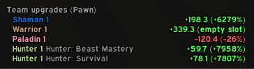

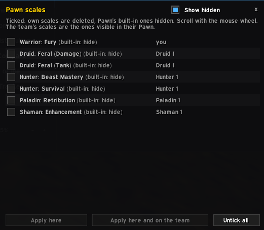

## Team Gear

A button on the character panel: see any member's equipped items, like inspecting them - also
while they're offline. The items come from Item Compare's stored gear (needs Item Compare on).

- Item names, item levels and enchants, average item level, when the gear last changed.
- Their 3D model while they're in your group and in sight, else their race and gender wearing the
  stored gear.
- **Talents**: the Talents button shows a member's three talent trees with every talent and its rank, and the
  points per tree (e.g. "Retribution 5 / 11 / 35"). Each client tells the team its talents when they change; the
  last ones known stay for offline members.
- **Whole team**: one row per member with every slot. A key binding opens and closes it (Key Bindings > MMT > Team Gear).
- **Minimap button** (an option, on by default): left-click picks a member, right-click shows the whole team; drag it
  around the minimap.
- Option: your other profiles' teams and every other character Item Compare stored on this account.
- Hover for the tooltip, Shift-click to link, Ctrl-click to try on, `<` `>` to step through.

`/mmtgear <name>` · `/mmtgear all`

| | |
| --- | --- |
| 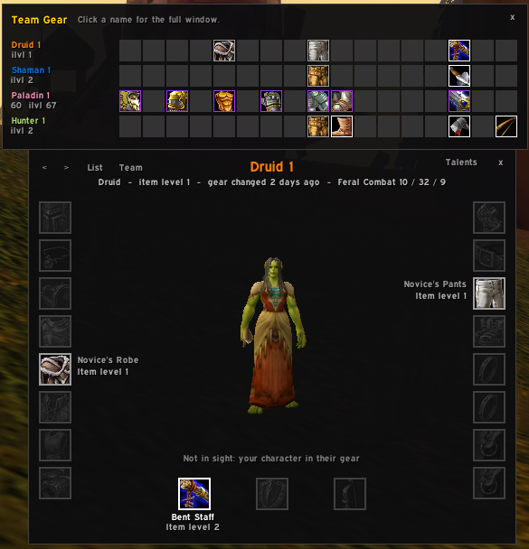 | 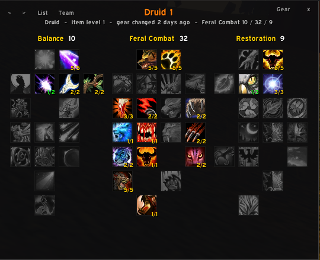 |

## Team Inventory

*Probably not ready yet, not heavily tested.* How many of an item your team has, across all your
accounts and characters - bags, bank, mail and equipped, also for members who are offline.

- **Tooltip**: the team's counts under the item, per character with a total. Next to Baganator /
  Syndicator (which list the account you're on) it adds your other accounts' characters below theirs.
- **Team bags**: a bag window for any character, the whole team added up, or the whole team by
  character - with Bags / Bank / Mail / Equipped tabs, a search box and **filters** that work
  together: BoE gear, soulbound items, crafting reagents, quest items and consumables, each Show /
  Hide / Include (with any on Include, only the included kinds are shown - the panel says which).
- Grouped in **Baganator's categories** when it's on (your order, custom and hidden categories,
  priorities and dragged items, read live), else in built-in ones like Baganator's defaults.
- **Side panel** beside the window, in every view: the team (click a name for their bags, drop an
  item on a name to give it to them) and the **trades** to do - who gives whom, the items, a
  **Trade** button and an "x" to cancel. It moves to the other side at the screen edge; it can be
  switched off in the settings.
- **Planned gifts**: on the Bags tab (any view), drag an item onto a name in the team list or onto
  another character's section (Shift: choose how many). From "Whole team" it comes from whoever has
  it; if several do, a list asks who gives it. Soulbound items (Bind on Pickup, quest items, an
  equipped Bind on Equip one) can't be dragged; the tooltip says why. It glows at the receiver with the giver's name on it, stays dimmed at the
  giver with the receiver's name. The next time those two trade, the giver's
  client puts it into the trade window. Accepting takes a key press (the game blocks addons from
  accepting): the **"Accept trade (planned gifts only)"** key (Keybindings > MMT (Manage My Team) > Team Inventory; with ISBoxer one
  key for all characters) or the "Accept planned gifts" button under the trade window - it accepts
  only a trade that is nothing but those gifts, else it says why. Right-click a glowing item
  to cancel. A "Planned items" button under the trade window fills it by hand. **Trade** in the
  panel makes the giver open the trade itself (they need to be grouped, or see each
  other's nameplate with friendly nameplates on).
- **Gold**: every character's gold (from MMT's heartbeat, kept while they're offline) in the side
  panel and the by-character headers, with the **total** below the team.
  Updates a few seconds after a trade, mail or vendor sale; the refresh icon (top bar and Team header) asks
  everyone online for their items and gold right away. Silver and copper can be hidden (settings > Look);
  the totals are always added up from the exact amounts.
- **Characters**: the team only (default), or every character Team Inventory has stored (other MMT profiles, old teams,
  other accounts' characters that were once in a team with this account) on this ruleset (PvE, PvP, ...) or on every ruleset,
  in the character list, the whole-team views, the panel and the total gold. Characters of another ruleset are tagged and can't be given items.
  The other characters are grouped by the team they were last played in ("Team: Anna, Bob", with that team's gold in the
  panel). Switch it in the settings (Team bags tab) or at the bottom of the character list in the team bags.
  A client can only know characters it has heard from: another account's saved files can't be read in game.
- **Look** tab in the settings: window size, background (colour, opacity, LibSharedMedia texture),
  border colour, icon size, columns, spacing, quality colours, count font and size.
- Open it from the minimap button (left-click bags, right-click bank) or a key (Keybindings >
  MMT (Manage My Team) > Team Inventory).
- The bank and mailbox are counted while open: open them once on each character.
- Each client counts its own items and shares them; only changes are sent after the first time.

`/mmtinv bags` · `/mmtinv bank` · `/mmtinv mail` · `/mmtinv send` · `/mmtinv request`

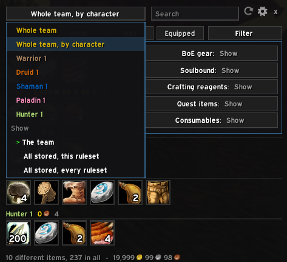

| | |
| --- | --- |
|  | 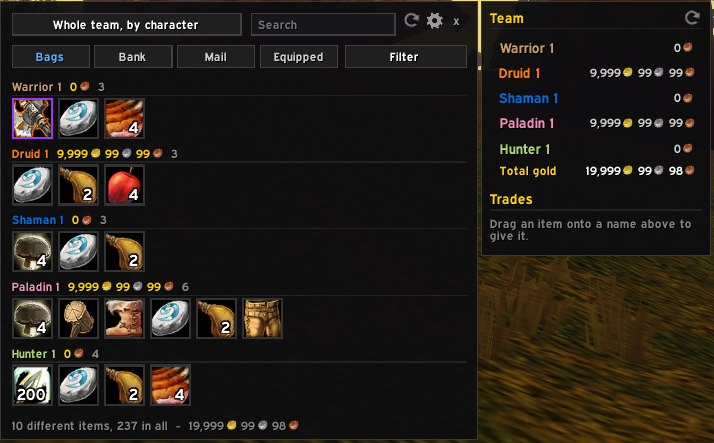 |
|  |  |

## Whispers

Inspired by the Talk module of [EMA](https://github.com/ebonyfaye/ema) by EbonyFaye (written new,
not copied): whispers your alts get show up on the character you play.

- Shown in a chat window of the receiver (the group leader by default; or MMT's FTL leader, a chosen
  character, or everyone with an MMT role), with clickable names, timestamps and a sound.
- What the alts whisper back is shown too.
- **Answer through the alt**: whisper it, and it passes the text on to whoever last whispered it
  (`@Name text` picks someone else). R can reply through the alt or straight to the sender.
- Optional Battle.net whispers (never real names). Automatic answers (`<DBM> ...`) and whispers with
  ignored words stay on the alt.

`/mmtw` · `/mmtw test`

## Quality of life

Small team conveniences, each on its own tab with its own checkbox and options (greyed out when its addon isn't loaded).

- **Dejunk lists**: an item you put on (or take off) one of [Dejunk](https://www.curseforge.com/wow/addons/dejunk)'s
  junk / not junk lists goes on (or off) the same list on every team member - global lists, and optionally
  the profile lists. Baganator's junk marks follow Dejunk, so they sync too. Changes show up right away: they go
  through Dejunk's own "Add to / Remove from list" key bindings, so the ones you haven't bound get
  ALT-CTRL-SHIFT-F13 to F20 (you see them in Dejunk > Keybindings; works from the first `/reload` with this version).
  With "Take changes right away" off they count after a `/reload` - **Reload the team for Dejunk**
  (or `/mmtqol dejunk reload`) reloads just the characters that took changes.
- **Baganator categories**: items you drag into a Baganator category (or out of it) go into the same category
  on every team member, right away - every category, or only Junk. Custom categories are matched by name.
  **Link Junk with Dejunk** (on by default): an item you drag into Baganator's Junk also goes on Dejunk's junk
  list (so Dejunk sells it), and one you take off Dejunk's junk list (or out of Junk) leaves both - then both syncs
  pass it to the team.
  **Send my whole category setup** gives the team your categories, order and sections through Baganator's
  own import (each character is asked first).
- **ForeverAuras**: send an aura, a group (with everything inside it) or all your auras to one team member or the
  whole online team. Open the window with the **Send to team** button above ForeverAuras' options (it opens beside
  them), `/mmtqol auras` or the settings page; pick the aura (sorted into Loaded / Not loaded like ForeverAuras' list; groups start closed: + or double-click opens one) and who gets it, Send. Opened beside ForeverAuras, it closes with it. The others are told it's coming,
  get a dialog (Import / Ignore; can be switched off), then ForeverAuras' own import window for each aura, one after
  the other - an aura they already have shows what changes, like pasting an import string. You hear back when they
  import or ignore it. Option: only the FTL leader may send you auras. Auras are a few KB each; a big group or "all"
  can be 100 KB and more, which takes a minute or two (the team's messages share about 800 bytes a second).
- **EllesmereUI profiles**: send one of your EllesmereUI profiles - complete, like its own export: every module,
  the layout, Cooldown Manager spells - or your **full account** export (account-wide settings + your active profile)
  to one team member or the whole online team. **Send to team** above EllesmereUI's options, `/mmtqol eui` or the
  settings page. The others are told it's coming and asked (Import / Ignore), then EllesmereUI's own import page
  opens with the profile name filled in - they pick the modules and the name there, like pasting the string. A full
  account export is always asked, shows EllesmereUI's typed "Confirm" warning and reloads. A profile is tens of KB:
  about a minute per member.
- **SmartBuff alerts**: when [SmartBuff](https://www.curseforge.com/wow/addons/smartbuff) on a character says a buff is
  missing (or runs out), the FTL leader gets it as a chat line, raid warning text and sound ("Bob: Anna needs Arcane
  Intellect") - also with SmartBuff's own splash or sound off on that character. Once a minute per target and buff,
  right away when it changes, and again after each fight (also a fight only the group was in); the same alert from several characters shows once. Names follow
  MMT's privacy setting (Team > Privacy). Options: send my alerts, buffs running
  out too, how often, show the team's alerts on the leader / every character / not here, raid warning text, sound.
- Options for Dejunk and Baganator: additions and / or removals, ask before taking changes (a dialog with Apply / Ignore) or
  take them right away, a chat line per change, and a button that sends your whole list once (the others
  add what they don't have). Many changes at once (an import, "Remove all", a reset) are not sent.

`/mmtqol` · `/mmtqol dejunk send` · `/mmtqol dejunk reload` · `/mmtqol baganator send` · `/mmtqol auras` · `/mmtqol eui` · `/mmtqol smartbuff combat`

## Styles

Another look for MMT's settings window and every window built from MMT's widgets - the core's (dropdown lists,
colour picker, dialogs, Item Compare's tooltips, the death panel ...) and the modules' (Team bags, Team Gear,
Pawn scales, the ForeverAuras / EllesmereUI send windows, Totem presets, Import / Export ...). Pick it from a
dropdown; it switches right away, no `/reload`, and **None** gives MMT's own look back exactly.

- **ElvUI**: flat dark panels, 1 pixel black edges with a faint line inside, ElvUI's blue, a narrow outlined font.
  Section headers in the accent colour; the widget under the mouse gets accent-coloured edges; a drawn dropdown arrow.
- **EllesmereUI**: warm dark glassy panels with a soft light at the top, faint white edges with soft corners and a
  shadow, EllesmereUI's accent colour (its own when it's installed) and its Expressway font when it's installed.
  Dimmed text that lights up under the mouse, faint capital section headers, see-through buttons.
- **Modern Blizzard**: the game's own current window art - the metal window rim (its title band above the window),
  the red buttons and close button, the settings list's highlight for selected rows, the minimal slider, the modern
  dropdown arrow, gold text; lists and boxes dark with a grey edge like the game's menus. Each piece only when the
  client has it (else Classic's).
- **Classic**: the game's own old window art - the carved dialog border on windows (background: stone, marble,
  tooltip blue or the old dark dialog - pick it on the page), thin tooltip borders on the classic tooltip blue for
  lists, the old dropdowns with their round arrow button, the old edit boxes, the red panel buttons (darker while
  pressed), the yellow check mark, the metal slider knob, the round close button, gold where MMT is blue.
- Options: the style's font, the style's accent colour. Saved per account (every character and profile).
- With EllesmereUI or ElvUI installed, switching Styles on asks once whether MMT should match it (only while you
  haven't picked a style yourself).
- Made new from colours and WoW's own fonts: nothing of ElvUI or EllesmereUI is copied, and MMT's files aren't
  changed (the style is put on from outside). The Cooldown / Buff Timers and Totem bars keep their own Look tab.

`/mmtstyle` · `/mmtstyle none | elvui | ellesmere | modern | classic` · `/mmtstyle frame` (what the style did to the window under the mouse)

---

## Development

This repository lives directly in `Interface/AddOns`; the `.gitignore` ignores every other addon
and only lists our own module folders. Tests run the modules in Lua 5.1 (the same as WoW) through
Python and [lupa](https://github.com/scoder/lupa): `python tests/run_all.py`.
