# Quiding's MMT modules

Modules for [MMT - Manage My Team](https://github.com/bnetworking/MMT), a multiboxing addon for
World of Warcraft: Forever. Each module is its own addon folder and shows up in `/mmt` under
MODULES, with its own settings page.

| Module | What it does | Version |
| --- | --- | --- |
| [Cooldowns](#cooldowns) | Bars with every member's important cooldowns | 0.8.6 |
| [Buffs](#buffs) | Who has, and who misses, the buffs you track | 0.7.5 |
| [Totems](#totems) | Totem bars for the team's shamans *(not heavily tested yet)* | 0.4.3 |
| [Pawn Compare](#pawn-compare) | Pawn scores for the whole team in the item tooltips | 0.3.0 |
| [Team Gear](#team-gear) | Any member's equipped gear, like inspecting them | 0.1.0 |
| [Team Inventory](#team-inventory) | Item counts and bags across all accounts *(not heavily tested yet)* | 0.8.0 |
| [Whispers](#whispers) | Your alts' whispers on the character you play | 0.1.4 |

## Install

1. Copy the `MMT_*` folders next to the `MMT` folder in
   `World of Warcraft/_classic_beta_/Interface/AddOns/` on every client.
2. `/reload` (or log in) and switch the modules on under `/mmt` > MODULES if needed.
3. Recommended: [Baganator](https://www.curseforge.com/wow/addons/baganator) - Team Inventory then
   uses its categories and puts its tooltip lines right below Baganator's.

Cooldowns and Buffs have a **Preview** (Bars tab, or `/mmtcd preview [mixed]` / `/mmtbf preview`): every team
member gets a row with made-up states, to set up the look and position without the team around -
with the team's real classes, or **mixed classes** (`/mmtcd preview mixed`: warrior, paladin, priest, ...).

Every settings page has **Sync to team** (MMT's own: the other clients are asked first) and
**Reset to defaults** (click twice). Cooldowns, Buffs and Totems also have **Import / Export** as a
text string, a growth direction (top > down, down > top, left > right, right > left) and
background / border / font options.

---

## Cooldowns

Port of [EMA Cooldowns](https://github.com/Quiding/ema_cooldowns): one row per member with their
important spells, trinkets and potions.

- Every client sends **one short message** when its character uses a tracked cooldown (exact time
  left), so members outside the group are tracked too; group members are also seen directly.
- While a spell's buff is up (Berserking, Evasion, Death Wish, trinkets, ...) its icon glows with
  the buff's time left.
- Lists per class, race, MMT role or character; entries can be switched off without deleting them.
- **Presets** from Wowhead's WoW: Forever data: per class (recommended / major only / everything),
  racials per race, potions & runes.
- **Name search** in the add box: every spell (also ones your character doesn't know) and the items
  you carry; shift-click a spell or item works too.

`/mmtcd` · `/mmtcd test` · `/mmtcd preview [mixed]` · `/mmtcd export`

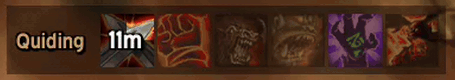

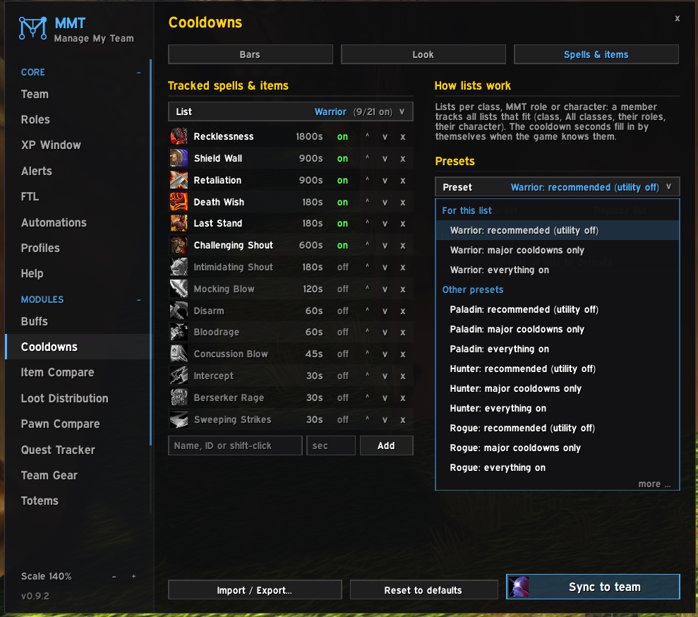

## Buffs

Port of [EMA Buffs](https://github.com/Quiding/ema_buffs): which group members have or miss the buffs
tracked for them, with exact timers.

- Any rank counts, and group versions too (Prayer of Fortitude, Greater Blessings, ...).
- Own window, or attached to the Cooldowns bars.
- Missing buffs: normal icon, red or grey, optionally glowing, at their own opacity.
- Class buffs (Fortitude, Mark of the Wild, Blessings, Arcane Intellect, ...) only show when someone of
  that class is in your group or online in your team (switchable).
- **All bar**: the team-wide buffs in one place (missing when anyone lacks one, otherwise the
  shortest time left); members can be left out of it.
- Presets (raid buffs, world buffs, flasks & elixirs, per class) and the same name search as Cooldowns.
- **Only for...** (the cog of each buff in the All bar): limit a buff to player roles (Tank / Healer / Melee / Ranged /
  Caster), classes and / or MMT roles - e.g. Blessing of Might only for Melee and Tank. Members it isn't
  for don't count as missing it. Player roles are automatic: a druid's form, else the talent tree with the
  most points (shared with the team, also right after a respec or dual spec swap), else the class; set
  them by hand on the Roles tab.

`/mmtbf` · `/mmtbf test` · `/mmtbf preview [mixed]` · `/mmtbf export`

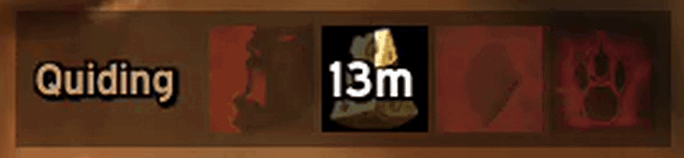

| | |
| --- | --- |
| 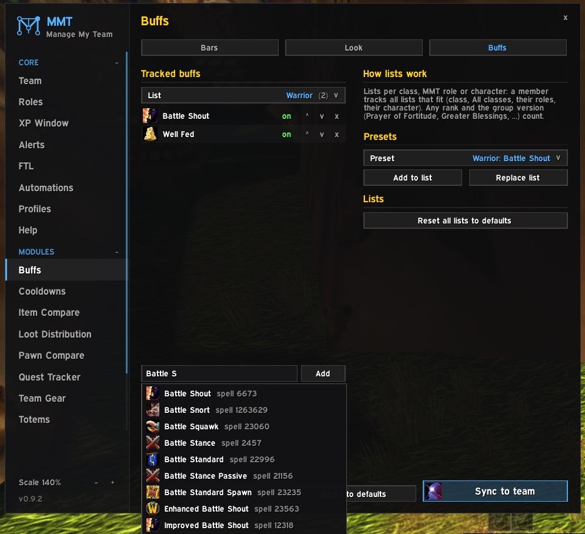 | 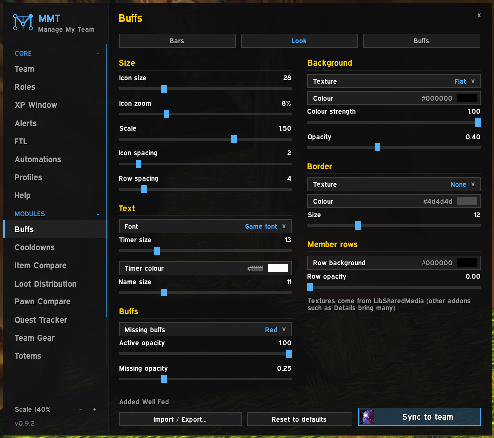 |

## Totems

*Probably not ready yet, not heavily tested.* Port of
[EMA Totems](https://github.com/Quiding/ema_totems): a bar per shaman (Fire, Air, Water, Earth).

- Active totem with its timer, else the chosen / last one.
- Right-click a slot to choose a totem (only the ones that shaman has learned), left-click your own
  to cast it.
- A cast sequence (reorder the four element buttons) on a key, spam-safe option.
- Individual and team presets (P / TP buttons), grouped or ungrouped bars.
- Slots hide when the shaman has no totem item or no totem of that element learned yet.

`/mmtt` · `/mmtt test` · `/mmtt presets` · `/mmtt export`

## Pawn Compare

Pawn scores for the whole team. Needs MMT's Item Compare switched on.

- In Item Compare's tooltips: each member's score for the hovered item with **their** Pawn scales,
  against what they have equipped (a two-hander against main + off hand).
- In the normal item tooltip: every member's gain from the item, replacing Pawn's own lines
  (or below them, or off).
- Members whose class can never use the item (a bow for a shaman) get no value.
- Scales are synced and stored, so offline members and clients without Pawn still work.

`/mmtpc` · `/mmtpc send` · `/mmtpc request`

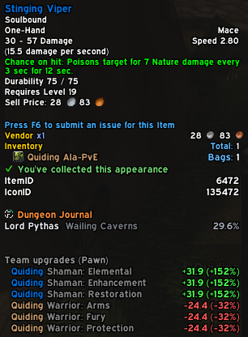

## Team Gear

A button on the character panel: see any member's equipped items, like inspecting them - also
while they're offline. The items come from Item Compare's stored gear (needs Item Compare on).

- Item names, item levels and enchants, average item level, when the gear last changed.
- Their 3D model while they're in your group and in sight, else their race and gender wearing the
  stored gear.
- **Whole team**: one row per member with every slot.
- Option: your other profiles' teams and every other character Item Compare stored on this account.
- Hover for the tooltip, Shift-click to link, Ctrl-click to try on, `<` `>` to step through.

`/mmtgear <name>` · `/mmtgear all`

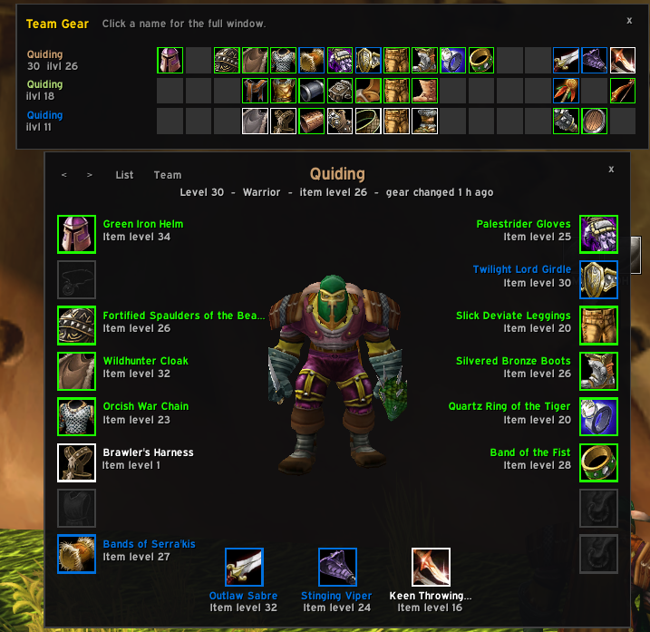

## Team Inventory

*Probably not ready yet, not heavily tested.* How many of an item your team has, across all your
accounts and characters - bags, bank, mail and equipped, also for members who are offline.

- **Tooltip**: the team's counts under the item, per character with a total. Next to Baganator /
  Syndicator (which list the account you're on) it adds your other accounts' characters below theirs.
- **Team bags**: a bag window for any character, the whole team added up, or the whole team by
  character - with Bags / Bank / Mail / Equipped tabs, a search box and **filters** that work
  together: BoE gear, soulbound items, crafting reagents, quest items and consumables, each Show /
  Hide / Include (with any on Include, only the included kinds are shown - the panel says which).
- Grouped in **Baganator's categories** when it's on (your order, custom and hidden categories,
  priorities and dragged items, read live), else in built-in ones like Baganator's defaults.
- **Side panel** beside the window, in every view: the team (click a name for their bags, drop an
  item on a name to give it to them) and the **trades** to do - who gives whom, the items, a
  **Trade** button and an "x" to cancel. It moves to the other side at the screen edge; it can be
  switched off in the settings.
- **Planned gifts**: on the Bags tab (any view), drag an item onto a name in the team list or onto
  another character's section (Shift: choose how many). From "Whole team" it comes from whoever has
  it; if several do, a list asks who gives it. Soulbound items (Bind on Pickup, quest items, an
  equipped Bind on Equip one) can't be dragged; the tooltip says why. It glows at the receiver with the giver's name on it, stays dimmed at the
  giver with the receiver's name. The next time those two trade, the giver's
  client puts it into the trade window. Accepting takes a key press (the game blocks addons from
  accepting): the **"Accept trade (planned gifts only)"** key (Keybindings > AddOns; with ISBoxer one
  key for all characters) or the "Accept planned gifts" button under the trade window - it accepts
  only a trade that is nothing but those gifts, else it says why. Right-click a glowing item
  to cancel. A "Planned items" button under the trade window fills it by hand. **Trade** in the
  panel makes the giver open the trade itself (they need to be grouped, or see each
  other's nameplate with friendly nameplates on).
- **Gold**: every character's gold (from MMT's heartbeat, kept while they're offline) in the side
  panel and the by-character headers, with the **total** below the team.
- **Characters outside the team** (other MMT profiles, old teams): hidden unless switched on.
- **Look** tab in the settings: window size, background (colour, opacity, LibSharedMedia texture),
  border colour, icon size, columns, spacing, quality colours, count font and size.
- Open it from the minimap button (left-click bags, right-click bank) or a key (Keybindings >
  AddOns > MMT - Team Inventory).
- The bank and mailbox are counted while open: open them once on each character.
- Each client counts its own items and shares them; only changes are sent after the first time.

`/mmtinv bags` · `/mmtinv bank` · `/mmtinv mail` · `/mmtinv send` · `/mmtinv request`

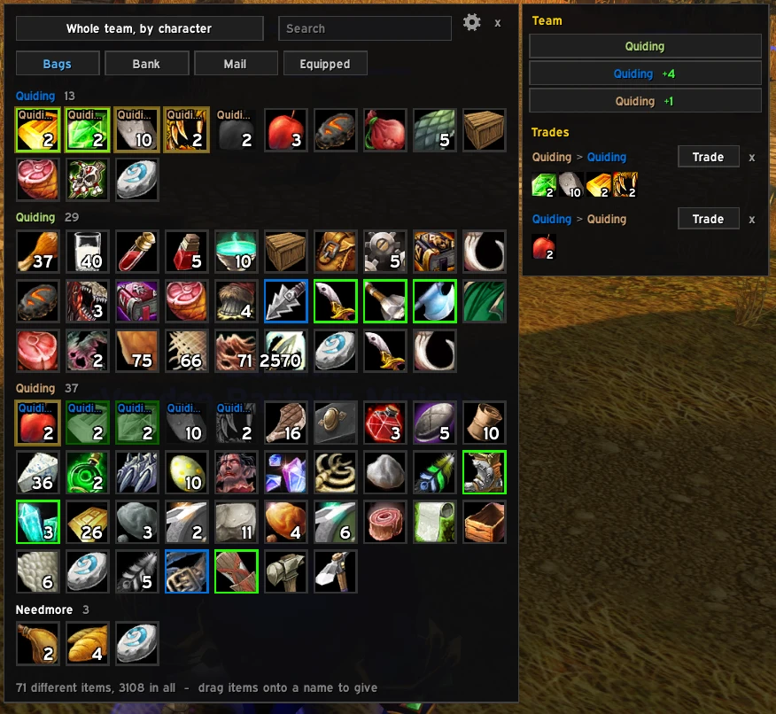

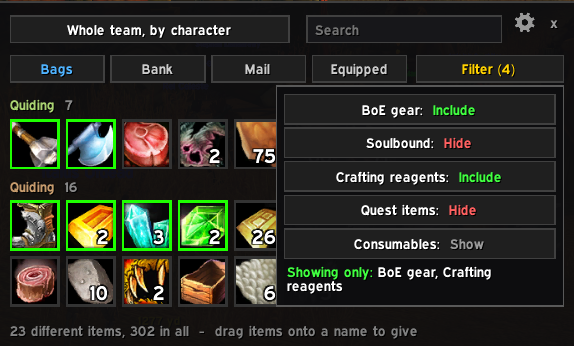

| | |
| --- | --- |
| 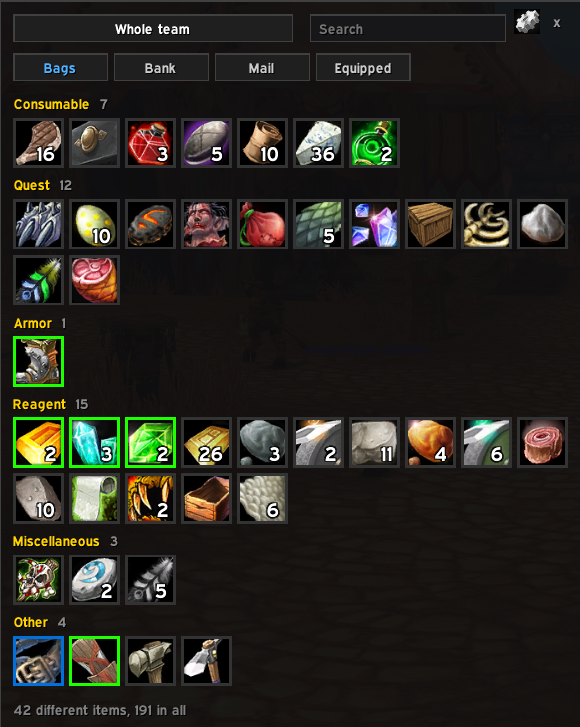 | 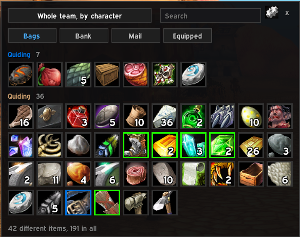 |
| 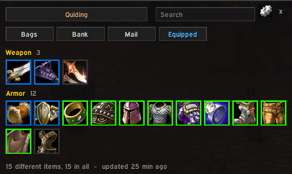 | 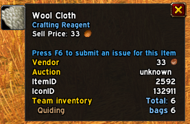 |

## Whispers

Inspired by the Talk module of [EMA](https://github.com/ebonyfaye/ema) by EbonyFaye (written new,
not copied): whispers your alts get show up on the character you play.

- Shown in a chat window of the receiver (the group leader by default; or MMT's FTL leader, a chosen
  character, or everyone with an MMT role), with clickable names, timestamps and a sound.
- What the alts whisper back is shown too.
- **Answer through the alt**: whisper it, and it passes the text on to whoever last whispered it
  (`@Name text` picks someone else). R can reply through the alt or straight to the sender.
- Optional Battle.net whispers (never real names). Automatic answers (`<DBM> ...`) and whispers with
  ignored words stay on the alt.

`/mmtw` · `/mmtw test`

---

## Development

This repository lives directly in `Interface/AddOns`; the `.gitignore` ignores every other addon
and only lists our own module folders. Tests run the modules in Lua 5.1 (the same as WoW) through
Python and [lupa](https://github.com/scoder/lupa): `python tests/run_all.py`.
